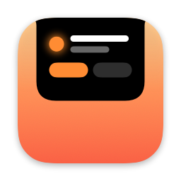
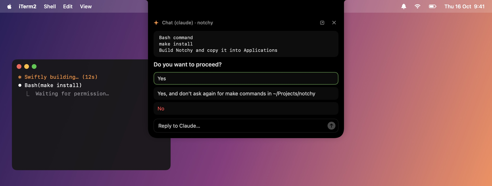
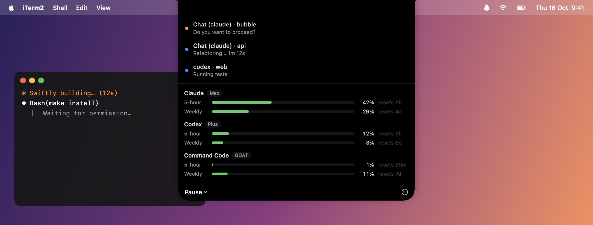

<div align="center">



# Notchy

**Your terminal, answered from the notch.**

When Claude Code or any CLI stops to ask you something, Notchy drops it out of your MacBook's notch.<br>
Click an answer and it types it into the right terminal tab. No more hunting for the tab that's waiting on you.

[](https://github.com/Adityaadpandey/notchy/releases/latest)


[](LICENSE)



</div>

## Install

```sh
curl -fsSL https://raw.githubusercontent.com/Adityaadpandey/notchy/main/install.sh | bash
```

Or with Homebrew:

```sh
brew install --cask adityaadpandey/tap/notchy
```

Both put Notchy in Applications and open it. Run the same command again to update.

<details>
<summary>Prefer a disk image?</summary>

Download **Notchy.dmg** from the [latest release](https://github.com/Adityaadpandey/notchy/releases/latest) and drag Notchy onto Applications.

Notchy isn't notarized by Apple yet, so the first time you open it macOS will say it can't check it. Open **System Settings → Privacy & Security**, scroll down, and click **Open Anyway**. The two commands above skip this step.

</details>

**You'll need** macOS 14 Sonoma or later, and [iTerm2](https://iterm2.com) or the Terminal app that comes with your Mac. No notch? Notchy hangs from the top middle of the screen instead.

## Getting set up

It takes about a minute, and Notchy asks for everything as it goes:

1. **Allow Notchy to control iTerm2 or Terminal** when macOS asks. That's how it reads prompts and types your answers.
2. **Connect Claude Code** (optional). Hover over the notch and click the button. Cards then show the exact command or diff you're approving, and Notchy pings you when Claude finishes.
3. **Allow Keychain access** (optional) the first time Notchy shows your Claude usage. Choose *Always Allow*, or *Deny* to skip Claude usage.

## What it does

### Answers prompts from the notch

When a tab you're not looking at needs you, a card opens out of the notch with the question and its choices. Click one, or type a reply. The card folds back away the moment you answer.

It understands:

- Claude Code permission prompts, multiple-choice questions and multi-select checkboxes
- `[y/N]` and `(yes/no)` questions from any CLI
- Arrow-key lists and checkbox lists (Inquirer, Clack, Prompts…)
- Plain questions like `Project name:` once the screen goes quiet

Anything asking for a password stays in the terminal.

In Terminal, Notchy can only type a line and press Enter, so a few answers need keys Terminal can't send: ticking checkboxes, typing your own reply to a Claude menu, and Claude's prompts with several questions. For those the card's ↗ button takes you to the tab. iTerm2 handles everything.

### Shows what's running and how much you have left



Hover over the notch (or click it) to see every tab that's waiting or working, plus your **5-hour and weekly limits for Claude, Codex and Command Code**, with when each one resets. Notchy shows whichever of these tools you're signed in to.

### Works from the keyboard

Press **⌃⌥Space** to put the keyboard on the top card. Press it again to move to the next one.

| Key | Does |
|---|---|
| `1`–`9` | Pick a choice |
| `Y` / `N` | Answer a yes/no question |
| `←` / `→` | Move between questions |
| `Tab` | Jump to the reply box |
| `Esc` | Hand the keyboard back to your app |

### And a few more things

- **Pause** Notchy for an hour, or until you resume it, from the dashboard.
- **Nudges you once** if a prompt has been waiting for two minutes.
- **Teach it a new CLI** in **⋯ → Edit prompt patterns…**: one regex per line, matched against the last line of each tab.
- **Opens at login.** Turn that off in the **⋯** menu.

## Privacy

Everything stays on your Mac. Notchy reads your terminal tabs locally and never sends them anywhere.

For usage limits it reuses the logins those tools already saved on your Mac (Claude Code's in the Keychain, `~/.codex/auth.json` and `~/.commandcode/auth.json`). It sends each login only to that tool's own server, making the same request the tool makes for its own usage screen, and never changes or refreshes it.

Connecting Claude Code adds two hooks to `~/.claude/settings.json` and leaves your other hooks alone. The original file is backed up as `settings.json.before-notchy`.

## Troubleshooting

<details>
<summary>No cards show up</summary>

Check **System Settings → Privacy & Security → Automation** and make sure Notchy is allowed to control iTerm2 or Terminal, whichever you use. If it was denied, the dashboard shows a button that takes you there. Cards also don't open for the tab you're already looking at.

</details>

<details>
<summary>Claude usage says "Keychain access was denied"</summary>

You clicked Deny on the Keychain prompt. Quit and reopen Notchy to be asked again.

</details>

<details>
<summary>Where are the logs?</summary>

`~/Library/Logs/Notchy.log` has one line for every card opened or closed and every answer sent.

</details>

## Uninstall

```sh
brew uninstall --cask notchy        # if you installed with Homebrew
```

Otherwise quit Notchy from the **⋯** menu and drag it from Applications to the Bin.

If you connected Claude Code, also remove the two entries ending in `Notchy hook` from `~/.claude/settings.json` (or restore `settings.json.before-notchy`). Notchy's own files live in `~/.config/notchy` and `~/Library/Logs/Notchy.log`.

## Building from source

You'll need the Xcode command line tools (`xcode-select --install`).

```sh
make install   # build and install to ~/Applications
make check     # run the tests
make dmg       # build the disk image
make icon      # redraw the app icon from Tools/icon.swift
```

**Releasing:** bump `CFBundleShortVersionString` in `Info.plist`, then run `make release`. It publishes the zip and the disk image on GitHub, and updates the [Homebrew cask](https://github.com/Adityaadpandey/homebrew-tap) to the new version.

## License

[MIT](LICENSE). Use it, change it, share it.
