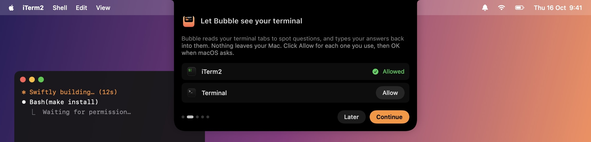

<div align="center">


# Bubble

**Your terminal, answered from the notch.**

When Claude Code or any CLI stops to ask you something, Bubble drops it out of your MacBook's notch.<br>
Click an answer and it types it into the right terminal tab. No more hunting for the tab that's waiting on you.

[](https://github.com/Adityaadpandey/bubble/releases/latest)


[](LICENSE)


</div>

## Install

```sh
curl -fsSL https://raw.githubusercontent.com/Adityaadpandey/bubble/main/install.sh | bash
```

Or with Homebrew:

```sh
brew install --cask adityaadpandey/tap/bubble
```

Both put Bubble in Applications and open it. Run the same command again to update.

Please install with one of these rather than downloading the zip in your browser. Bubble isn't notarized by Apple yet, so a browser download opens with "Apple could not verify Bubble.app". The commands above never show that.

**You'll need** macOS 14 Sonoma or later, and one of [iTerm2](https://iterm2.com), the Terminal app that comes with your Mac, [tmux](#other-terminals), [kitty](#other-terminals) or [WezTerm](#other-terminals). No notch? Bubble hangs from the top middle of the screen instead.

## Getting set up

The first time you open Bubble, a short welcome drops out of the notch and walks you through setup. It takes about a minute, and macOS only asks for a permission when you click the button for it, never all at once.



1. **Your terminal.** Click **Allow** next to iTerm2 and Terminal (whichever you use), then **OK** when macOS asks. That's how Bubble reads prompts and types your answers. tmux, kitty and WezTerm don't need this, see [Other terminals](#other-terminals).
2. **Claude Code** (optional, only if it's installed). **Connect** adds two hooks to Claude Code's settings, so cards show the exact command or diff you're approving and Bubble pings you when Claude finishes.
3. **Usage limits** (optional). **Show my limits** brings up macOS's Keychain prompt so Bubble can read Claude Code's login. Choose *Always Allow*. Skip it and Bubble leaves the Keychain alone until you open the dashboard.
4. **Done.** Choose whether Bubble opens at login, and you're set.

Click **Later** or press Esc to finish setting up another time. You can reopen the welcome any time from **⋯ → Welcome to Bubble…**.

## What it does

### Answers prompts from the notch

When a tab you're not looking at needs you, a card opens out of the notch with the question and its choices. Click one, or type a reply. The card folds back away the moment you answer.

It understands:

- Claude Code permission prompts, multiple-choice questions and multi-select checkboxes
- `[y/N]` and `(yes/no)` questions from any CLI
- Arrow-key lists and checkbox lists (Inquirer, Clack, Prompts…)
- Plain questions like `Project name:` once the screen goes quiet

Anything asking for a password stays in the terminal.

In Terminal, Bubble can only type a line and press Enter, so a few answers need keys Terminal can't send: ticking checkboxes, typing your own reply to a Claude menu, and Claude's prompts with several questions. For those the card's ↗ button takes you to the tab. iTerm2, tmux, kitty and WezTerm handle everything.

### Other terminals

Bubble reads and answers these through their own command line tools, so they need no Automation permission:

- **tmux** works with no setup, and in any terminal you run it in, including Ghostty, Warp, Alacritty and the VS Code terminal.
- **kitty** needs remote control on a socket. Add these two lines to `kitty.conf` and restart kitty:
  ```
  allow_remote_control socket-only
  listen_on unix:/tmp/kitty
  ```
- **WezTerm** works with no setup.

Ghostty, Warp and Alacritty can't be read from outside, so use tmux in them.

### Pings you when a tool finishes

Claude Code does this once you've connected it. For anything else that can run a command when it's done, call `Bubble notify`, and a card opens on that tab:

```sh
/Applications/Bubble.app/Contents/MacOS/Bubble notify "Build finished"
```

**pi** has an extension for it. Copy [`integrations/pi-bubble.ts`](integrations/pi-bubble.ts) to `~/.pi/agent/extensions/bubble.ts` and Bubble pings you whenever pi has finished and won't carry on by itself.

### Shows what's running and how much you have left


Hover over the notch (or click it) to see every tab that's waiting or working, plus your **5-hour and weekly limits for Claude, Codex and Command Code**, with when each one resets. Bubble shows whichever of these tools you're signed in to.

### Works from the keyboard

Press **⌃⌥Space** (or the shortcut you picked in Settings) to put the keyboard on the top card. Press it again to move to the next one.

| Key | Does |
|---|---|
| `1`–`9` | Pick a choice |
| `Y` / `N` | Answer a yes/no question |
| `←` / `→` | Move between questions |
| `Tab` | Jump to the reply box |
| `Esc` | Hand the keyboard back to your app |

### Settings

Open **⋯ → Settings…** to change:

- **Alerts:** how long a prompt waits before Bubble reminds you again (or never), the sound, and the keyboard shortcut (or none).
- **Which terminals to watch** and **which usage meters to show.** One you turn off is never read, so macOS never asks to let Bubble control it, and Claude's Keychain prompt is skipped if its meter is off.
- **Look:** spacing, card width, text size and accent colour.

Changes apply straight away, and cards you open next use the new look.

### And a few more things

- **Pause** Bubble for an hour, or until you resume it, from the dashboard.
- **Nudges you once** if a prompt has been waiting for two minutes.
- **Teach it a new CLI** in **⋯ → Edit prompt patterns…**: one regex per line, matched against the last line of each tab.
- **Opens at login**, unless you turned that off during setup. Change it any time in the **⋯** menu.

## Privacy

Everything stays on your Mac. Bubble reads your terminal tabs locally and never sends them anywhere.

For usage limits it reuses the logins those tools already saved on your Mac (Claude Code's in the Keychain, `~/.codex/auth.json` and `~/.commandcode/auth.json`). It sends each login only to that tool's own server, making the same request the tool makes for its own usage screen, and never changes or refreshes it.

Connecting Claude Code adds two hooks to `~/.claude/settings.json` and leaves your other hooks alone. The original file is backed up as `settings.json.before-bubble`.

## Troubleshooting

<details>
<summary>No cards show up</summary>

Check **System Settings → Privacy & Security → Automation** and make sure Bubble is allowed to control iTerm2 or Terminal, whichever you use. If it was denied, the dashboard shows a button that takes you there. Cards also don't open for the tab you're already looking at.

</details>

<details>
<summary>Claude usage says "Keychain access was denied"</summary>

You clicked Deny on the Keychain prompt. Quit and reopen Bubble to be asked again.

</details>

<details>
<summary>Where are the logs?</summary>

`~/Library/Logs/Bubble.log` has one line for every card opened or closed and every answer sent.

</details>

## Uninstall

```sh
brew uninstall --cask bubble        # if you installed with Homebrew
```

Otherwise quit Bubble from the **⋯** menu and drag it from Applications to the Bin.

If you connected Claude Code, also remove the two entries ending in `Bubble hook` from `~/.claude/settings.json` (or restore `settings.json.before-bubble`). Bubble's own files live in `~/.config/bubble` and `~/Library/Logs/Bubble.log`.

## Building from source

You'll need the Xcode command line tools (`xcode-select --install`).

```sh
make install   # build and install to ~/Applications
make check     # run the tests
make icon      # redraw the app icon from Tools/icon.swift
```

**Releasing:** bump `CFBundleShortVersionString` in `Info.plist`, then run `make release`. It publishes the zip on GitHub, and updates the [Homebrew cask](https://github.com/Adityaadpandey/homebrew-tap) to the new version.

## License

[MIT](LICENSE). Use it, change it, share it.
